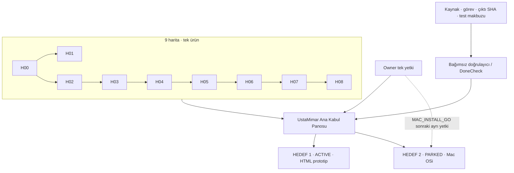

# ENGÜRÜ UstaMimar OSi™ — Ana Kabul Panosu / Mimari ve İşletim Sözleşmesi V1

**Tek ürün:** ENGÜRÜ UstaMimar OSi™. **Sistem ayrımı:** ENGÜRÜ Yerel Mac OSi™ ana işletim ortamı; UstaMimar onun içinde kişisel mühendis; ENGÜRÜ Builder OSi™ ayrı üretim fabrikasıdır. **Hedef 1 ACTIVE:** çalışan HTML prototip. **Hedef 2 PARKED:** yerel Mac OSi saha.
**Otorite:** Bu pano karar ve kanıt göstergesi; kendi başına ikinci motor, owner, DoneCheck v1.2 veya hafıza deposu değildir.

## Pano mimarisi

## Kanıtla beslenen tek hakikat
Panoda haritaların `DESIGN_SCOPE` ve `RUNTIME_SCOPE` alanları **farklıdır**. Kaynak, iş, çıktı ve kabul kanıtı `task_id / contract_sha256 / map_id / acceptance_id / artifact_sha256 / test_receipt / verifier_ref / owner_authority` bağıyla okunur. Şema/sürüm/SHA farklıysa `HOLD_SOURCE_DRIFT`. Yalnız kendi öz-yazarlı simülasyonu varsa `PASS_SCOPED_SIMULATION` fakat ürün `HOLD` kalır.

**Karar merdiveni:** kaynak kimliği → plan → owner kapsamı → gerçek izole görev → kod/dosya ve geri okuma → olumlu/negatif/kurtarma → bağımsız doğrulama → özgün 4H ilgili kontrol PASS → Hedef 1'e özgü çalışan HTML ürünü `HTML_PROTOTYPE_PASS` → Mac öncesi hazır olma → ayrı owner `MAC_INSTALL_GO` → gerçek Mac kabulü.

## Pano üzerindeki beş asli gösterge
1. **Hedef 1 durum ve açık nedenler:** Gerçek HTML–API–yürütücü çıktısı, iki gerçek mühendislik işi, negatif test, bağımsız denetim, kullanıcı kabulü.
2. **Hedef 2 (sabit PARKED):** Mac M01–M06, gerçek Ollama/Safari ve yerel restore bu aşamada `NOT_TESTED`.
3. **Harita 9/9 izleme:** Her harita teori/tasarım simülasyon durumu ayrı, gerçek teknik kabul ayrı.
4. **Özgün 56'lık 4H kontrol:** H01(8), H02(12), DG02(12), DG03(12), DG04(12); canonical orijinal metin erişilmediyse ID tanımı uydurulmaz, özgün eşleme açık kapı olur.
5. **Saray uzmanlığı:** HFS-S1..S5, K03/K04 HOLD ve 22 benzersiz gain kaydı korunur; taşıma henüz yapılmaz.

## Kaynak ve mevcut yetki ayrımı
V1, V1.1 ve V1.2 owner ürün sözleşmeleri; mevcut 14 R, 18 UM, 32 WC, W01–W15, 56 4H korunur. GitHub AGENTS ve canonical kaynaklar tasarım için salt-okunur gözlenmiştir; canlı GitHub bağlantısı ürün sözleşmesinde yoktur. Hedef 1'de Mac kurulum izni yok.

## Panonun teknik hazırlık arayüzü
Veri kaynağı tasarımda JSON veya görev defterinin salt-okunur projeksiyonu olabilir; mevcut canlı API rotası doğrulanmış değildir. İlk statik HTML pano bu mimari kayıtları okur, sekiz harita ile ana H00 görünümü arasında gezinir ve dürüst durumları gösterir. **HTML Panosu iş yapan Usta prototipi değildir.** Gerçek Hedef 1 uygulamasında veri `task_id` ve `verifier_ref` ile gelecek.

**Önerilen olay şeması:** `product_id, task_id, map_id, source_sha256, contract_sha256, acceptance_ids, target_id, execution_environment, artifact_sha256, test_receipt, verifier_ref, authority_ref, verdict, next_action`. Tek kontrol ancak kendi gerçek makbuzuyla PASS olur. Kısmi testte `PASS_SCOPED`; kanıt eksiğinde `HOLD`; saha hiç çalışmadıysa `NOT_TESTED`.

## Zülfikar V1.4.1 karşıt sınaması
- **P-SIM1:** Dokuz geçerli harita ve gerçek olmayan yalnız tasarım makbuzu → pano tasarım bağlantısı PASS_SCOPED, Hedef 1 HOLD, Hedef 2 PARKED.
- **P-SIM2:** Simülasyon `100/100` etiketi HTML ürünün PASS sonucuna taklit edilir → `FALSE_FINISH_REJECTED` ve PASS yok.
- **P-SIM3:** Hedef 2 yanlışlıkla ACTIVE yapılır veya Hedef 1 eksik kaynak nedeniyle HOLD olur → owner `MAC_INSTALL_GO` olmadan Mac saha kapısı kapalı; hatalı durum geri alınıp doğrulama tekrarlanır.

**Döngü onarım:** Her senaryoda RED/bozuk girdi → kök nedeni gözle → en küçük izinli şema onarımı → SIM1/2/3 yeniden çalıştır → regresyon → durum ve kanıtı ayrı yaz.

## Tasarım / teori / teknik hazırlık kapanışı
Pano `G01…G10` yapısal tasarım alanı ile kendi-yazarlı **100/100 tasarım bütünlüğü** gösterebilir, fakat gerçek HTML kullanıcı kabulü, Mac testleri, bağımsız oracle veya resmî Verified Finish olarak kullanılamaz. Yapısal kontrol koşulları ve makine sonuçları `SIMULASYON_KANIT.json` dosyasındadır.

**Sıradaki tek iş:** W02–W06 kaynak/ölçüt/izin ön hazırlığı ve Hedef 1 için gerçek HTML Usta işlerinin inşası; Hedef 2 `PARKED`.

## H04 muadil doğrulama eki
`MUADIL_YETENEK_EK_H04.md` dört muadili 32 WC başlığı ve 18 UM tasarım izleriyle ilişkilendirir. Dış gerçek kıyas `NOT_TESTED` olarak korunur.
