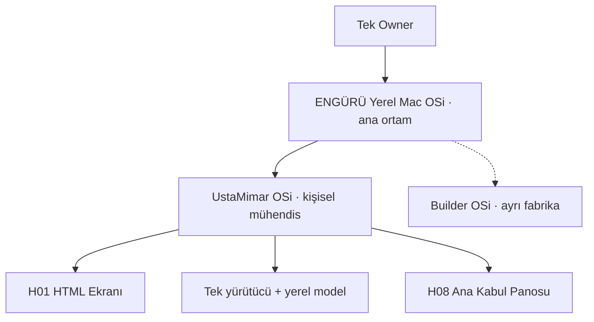

# H00 — Ana Sistem ve Yerleşim
## ENGÜRÜ UstaMimar OSi™ · Teori, Tasarım, Teknik Hazırlık ve Zülfikar V1.4.1

**Harita:** `H00` · **Hedef 1:** ACTIVE / HTML prototip · **Hedef 2:** PARKED / Mac OSi · **Yetki:** Owner.
**Kapsam hükmü:** `PASS_SCOPED_DESIGN_SELF_CHECKED_ONLY`. Bu harita, fiilen çalışan UstaMimar mühendislik ürününün ya da Mac kurulumu kabulünün kanıtı değildir.

### Niyet ve kapsam
Tek ürünün sınırlarını, üç OSi kimliğini ve bağımlılık ilişkisini sabitlemek.

**Ana soru:** UstaMimar ana Mac OSi içinde nereye oturur, hangi birimlerdir?
**Sorumlu rol:** Owner

### Kaynak ve bütünlük
Kaynak: owner V1.2 ürün kararı; V1.1 hizalama; V1 temel iş/kabul sözleşmesi; özgün UM V1 matrisi ve yalnız salt-okunur GitHub AGENTS.md referansı. Asıl SHA-256 eşlikleri üst `HARITALAR_V1_KAYNAK_MATRISI.json` içindedir. Git blob SHA-1 ile SHA-256 farklıdır; ana Saray'a yazma yetkisi türetilmez.

### Kuramsal ilkeler ve mimari sınırlar
- ENGÜRÜ Yerel Mac OSi = ana yerel ortam
- ENGÜRÜ UstaMimar OSi™ = kişisel mühendislik uygulaması
- ENGÜRÜ Builder OSi™ = ayrı fabrika; ilk hedefin bağımlılığı değil

### Şema

### Teknik giriş–çıkış ve bağlantı sözleşmesi
**Girdi**
- V1.2 owner ürün kimliği
- mevcut V0.1 izole pilot ve Mac Engineer kaynak kanıtı

**Çıktı**
- tek ürün/tek yürütücü mimari kararı
- bileşen–sorumluluk–veri sınırı şeması

**Arayüz ve veri bağı (hedef tasarım; mevcut API iddiası değil)**
- H01 HTML -> H06 görev zarfı
- H02 karar -> H03 araç çağrısı
- H07 güvenlik -> tüm modüller
- H08 kabul -> H00 görünür durum

**Bağlı üst/yan haritalar:** H01, H02, H03, H08.
**Korunan gereksinim/iş/yetenek izleri:** R01, R07, R09, R10, UM-05, UM-10, W01, W03, W04. 4H özgün H01/H02/DG02/DG03/DG04 koşulları ayrı asıl sözleşmelerden doğrulanır.

### Zülfikar V1.4.1 · Üçlü senaryo / onarım
- **SIM1 (normal):** 9 harita tek H00 omurgasında H08 panosuyla bağlanır; Hedef 1 ACTIVE, Hedef 2 PARKED. Beklenen hüküm `PASS_DESIGN_RULE_ONLY`; gerçek icra makbuzu talep edilirse `NOT_TESTED`.
- **SIM2 (karşıt):** Yanlışlıkla Hedef 2 ACTIVE veya GitHub canlı erişimi gösterilirse mimari denetim FAIL. Beklenen hüküm `SAFE_REJECT`, yetkisiz dış etki 0.
- **SIM3 (kesinti/onarım):** V1.2 ürün sınırına dön; tek uygulama, tek yürütücü kuralına göre bağı onar. Beklenen hüküm `HOLD_OR_RECOVERY_NOT_FAKE_FINISH`.
- **Döngü Onarım:** Gözlem → kök neden → dar değişiklik → yeniden SIM1/SIM2/SIM3 → regresyon → yalnız kanıtlı hüküm.

### Kabul şartı / beklenen teslim
**Tasarım uygunluğu:** 9 haritada ürün kimliği aynı, iki hedef ayrılmış, Builder hiçbir zaman tek yürütücü olarak gösterilmiyor.
**Tasarım riskleri:** Builder ile UstaMimar karıştırılması, V0.1 server.py ikinci ana üretim motoruna dönüşmesi.

**Yapısal tasarım değerlendirmesi (10 bağımsız anlam başlığı × 10 puan):** G01, G02, G03, G04, G05, G06, G07, G08, G09, G10. Bu belgede tüm alanlar bulunduğu için yerel kendi-yazarlı rubrik `100/100`; kapsam `SELF_ASSESSED_DESIGN`. Harici hakem veya gerçek teknik performans olarak değerlendirilmez.

**Hedef 1 gerçek bitiş için:** 9 haritada ürün kimliği aynı, iki hedef ayrılmış, Builder hiçbir zaman tek yürütücü olarak gösterilmiyor. İlgili kod, gerçek görev/araç/test makbuzları ve ürünün özgün kabul kimlikleri W07–W14 aşamasında ayrıca kanıtlanır.
**Hedef 2:** `PARKED`; `MAC_INSTALL_GO=NOT_GRANTED`, `W15/M01–M06=NOT_TESTED`. Gerçek işletim, gerçek model ve Mac saha yeteneği burada test edilmemiştir.
