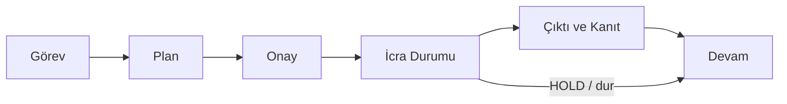

# H01 — HTML Ekranı ve Kullanıcı Deneyimi
## ENGÜRÜ UstaMimar OSi™ · Teori, Tasarım, Teknik Hazırlık ve Zülfikar V1.4.1

**Harita:** `H01` · **Hedef 1:** ACTIVE / HTML prototip · **Hedef 2:** PARKED / Mac OSi · **Yetki:** Owner.
**Kapsam hükmü:** `PASS_SCOPED_DESIGN_SELF_CHECKED_ONLY`. Bu harita, fiilen çalışan UstaMimar mühendislik ürününün ya da Mac kurulumu kabulünün kanıtı değildir.

### Niyet ve kapsam
Tek ekranla görev-plan-onay-ilerleme-sonuç-devam etkileşimini erişilebilir tasarlamak.

**Ana soru:** Tek kullanıcı hangi ekranda hangi gerçek işi görür?
**Sorumlu rol:** Owner + UI

### Kaynak ve bütünlük
Kaynak: owner V1.2 ürün kararı; V1.1 hizalama; V1 temel iş/kabul sözleşmesi; özgün UM V1 matrisi ve yalnız salt-okunur GitHub AGENTS.md referansı. Asıl SHA-256 eşlikleri üst `HARITALAR_V1_KAYNAK_MATRISI.json` içindedir. Git blob SHA-1 ile SHA-256 farklıdır; ana Saray'a yazma yetkisi türetilmez.

### Kuramsal ilkeler ve mimari sınırlar
- görev girişi / hedef / izinli çalışma alanı
- plan görüntüsü / açık onay ve iptal
- canlı durum / çıktı yolu / SHA / test makbuzu / devam

### Şema

### Teknik giriş–çıkış ve bağlantı sözleşmesi
**Girdi**
- H06 görev durumu salt okunur API
- H08 kabul verisi salt okunur görünümü

**Çıktı**
- görsel görev ekranı ve geri bildirim
- açılır ayrıntılı test makbuzları

**Arayüz ve veri bağı (hedef tasarım; mevcut API iddiası değil)**
- GET /api/task/{id} (tasarım; mevcut canlı rota değildir)
- POST /api/task/{id}/approve (tasarım; owner token ile)
- GET /api/dashboard (salt okunur özet, tasarım)

**Bağlı üst/yan haritalar:** H02, H06.
**Korunan gereksinim/iş/yetenek izleri:** R01, R02, UM-02, UM-18, W07, W09, W15. 4H özgün H01/H02/DG02/DG03/DG04 koşulları ayrı asıl sözleşmelerden doğrulanır.

### Zülfikar V1.4.1 · Üçlü senaryo / onarım
- **SIM1 (normal):** Dar görev girildiğinde plan ve izinli eylem görünür, makbuz olmadan PASS görünmez. Beklenen hüküm `PASS_DESIGN_RULE_ONLY`; gerçek icra makbuzu talep edilirse `NOT_TESTED`.
- **SIM2 (karşıt):** API başarısız yanıtında görsel PASS yazılmaz ve ilgili açık neden görünür. Beklenen hüküm `SAFE_REJECT`, yetkisiz dış etki 0.
- **SIM3 (kesinti/onarım):** Yeniden bağlantı/yenileme sonrası task_id ile eski makbuzlara geri dönülür. Beklenen hüküm `HOLD_OR_RECOVERY_NOT_FAKE_FINISH`.
- **Döngü Onarım:** Gözlem → kök neden → dar değişiklik → yeniden SIM1/SIM2/SIM3 → regresyon → yalnız kanıtlı hüküm.

### Kabul şartı / beklenen teslim
**Tasarım uygunluğu:** Klavye, ekran okuyucu, hata mesajı ve işin sonucu ölçülür; gerçek Safari kabulü W15 bekler.
**Tasarım riskleri:** yalnız HTML file:// ile yerel dosya yazabileceği sanılması, görev tamamlanmadan yeşil durum gösterilmesi.

**Yapısal tasarım değerlendirmesi (10 bağımsız anlam başlığı × 10 puan):** G01, G02, G03, G04, G05, G06, G07, G08, G09, G10. Bu belgede tüm alanlar bulunduğu için yerel kendi-yazarlı rubrik `100/100`; kapsam `SELF_ASSESSED_DESIGN`. Harici hakem veya gerçek teknik performans olarak değerlendirilmez.

**Hedef 1 gerçek bitiş için:** Klavye, ekran okuyucu, hata mesajı ve işin sonucu ölçülür; gerçek Safari kabulü W15 bekler. İlgili kod, gerçek görev/araç/test makbuzları ve ürünün özgün kabul kimlikleri W07–W14 aşamasında ayrıca kanıtlanır.
**Hedef 2:** `PARKED`; `MAC_INSTALL_GO=NOT_GRANTED`, `W15/M01–M06=NOT_TESTED`. Gerçek işletim, gerçek model ve Mac saha yeteneği burada test edilmemiştir.
