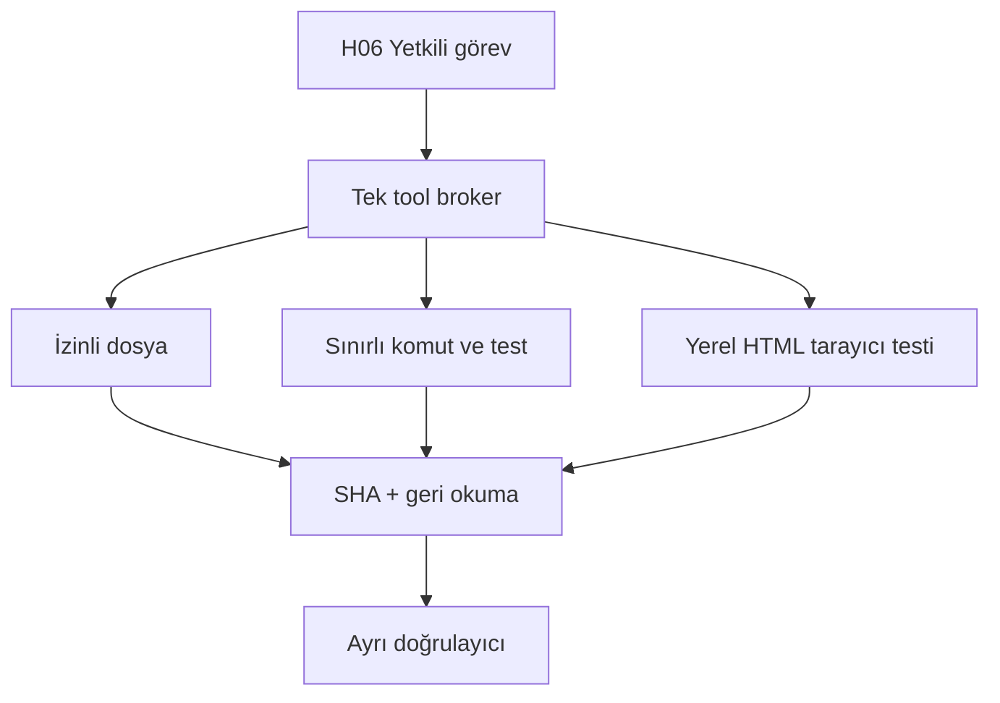

# H03 — Yürütücü ve Araç Mimarisi
## ENGÜRÜ UstaMimar OSi™ · Teori, Tasarım, Teknik Hazırlık ve Zülfikar V1.4.1

**Harita:** `H03` · **Hedef 1:** ACTIVE / HTML prototip · **Hedef 2:** PARKED / Mac OSi · **Yetki:** Owner.
**Kapsam hükmü:** `PASS_SCOPED_DESIGN_SELF_CHECKED_ONLY`. Bu harita, fiilen çalışan UstaMimar mühendislik ürününün ya da Mac kurulumu kabulünün kanıtı değildir.

### Niyet ve kapsam
Gerçek dosya ve kod işini mevcut tek yerel yürütücü ile yapmak.

**Ana soru:** Plan nasıl gerçek dosyaya, teste ve kanıta dönüşür?
**Sorumlu rol:** Güvenli tool broker

### Kaynak ve bütünlük
Kaynak: owner V1.2 ürün kararı; V1.1 hizalama; V1 temel iş/kabul sözleşmesi; özgün UM V1 matrisi ve yalnız salt-okunur GitHub AGENTS.md referansı. Asıl SHA-256 eşlikleri üst `HARITALAR_V1_KAYNAK_MATRISI.json` içindedir. Git blob SHA-1 ile SHA-256 farklıdır; ana Saray'a yazma yetkisi türetilmez.

### Kuramsal ilkeler ve mimari sınırlar
- V0.1 izole arayüz yeniden kullanım adayı
- Mac Engineer canlı süreç–kaynak SHA doğrulaması
- tek executor adaptörü / izolasyon / tool allowlist

### Şema

### Teknik giriş–çıkış ve bağlantı sözleşmesi
**Girdi**
- owner yetkili görev zarfı ve plan
- izinli dosya/komut argümanları

**Çıktı**
- diskte gerçek çıktı, önce/sonra SHA
- komut exit code, stdout/stderr, test makbuzu

**Arayüz ve veri bağı (hedef tasarım; mevcut API iddiası değil)**
- job_id↔task_id↔contract_sha256
- subprocess runner: allowlist+timeout; genel shell yetkisi yok
- her yan etki H06 checkpoint ile tekil

**Bağlı üst/yan haritalar:** H04, H05, H06.
**Korunan gereksinim/iş/yetenek izleri:** R03, R04, R08, R09, R10, R11, UM-04, UM-05, UM-06, UM-07, W03, W07, W08, W09. 4H özgün H01/H02/DG02/DG03/DG04 koşulları ayrı asıl sözleşmelerden doğrulanır.

### Zülfikar V1.4.1 · Üçlü senaryo / onarım
- **SIM1 (normal):** İzinli workspace içinde kod/dosya üretilir ve geri okunur. Beklenen hüküm `PASS_DESIGN_RULE_ONLY`; gerçek icra makbuzu talep edilirse `NOT_TESTED`.
- **SIM2 (karşıt):** Symlink escape, overwrite, süresiz shell ve yanlış SHA fail-closed reddedilir. Beklenen hüküm `SAFE_REJECT`, yetkisiz dış etki 0.
- **SIM3 (kesinti/onarım):** Kademeli staging + rollback; belirsiz yan etki HOLD_RECONCILE. Beklenen hüküm `HOLD_OR_RECOVERY_NOT_FAKE_FINISH`.
- **Döngü Onarım:** Gözlem → kök neden → dar değişiklik → yeniden SIM1/SIM2/SIM3 → regresyon → yalnız kanıtlı hüküm.

### Kabul şartı / beklenen teslim
**Tasarım uygunluğu:** İki farklı gerçek mühendislik işinde çıktı + test + geri okuma, Hedef 1 bağımsız kanıtla.
**Tasarım riskleri:** ikinci üretim motoru, kapsam dışı dosya yazımı veya kör patch.

**Yapısal tasarım değerlendirmesi (10 bağımsız anlam başlığı × 10 puan):** G01, G02, G03, G04, G05, G06, G07, G08, G09, G10. Bu belgede tüm alanlar bulunduğu için yerel kendi-yazarlı rubrik `100/100`; kapsam `SELF_ASSESSED_DESIGN`. Harici hakem veya gerçek teknik performans olarak değerlendirilmez.

**Hedef 1 gerçek bitiş için:** İki farklı gerçek mühendislik işinde çıktı + test + geri okuma, Hedef 1 bağımsız kanıtla. İlgili kod, gerçek görev/araç/test makbuzları ve ürünün özgün kabul kimlikleri W07–W14 aşamasında ayrıca kanıtlanır.
**Hedef 2:** `PARKED`; `MAC_INSTALL_GO=NOT_GRANTED`, `W15/M01–M06=NOT_TESTED`. Gerçek işletim, gerçek model ve Mac saha yeteneği burada test edilmemiştir.
