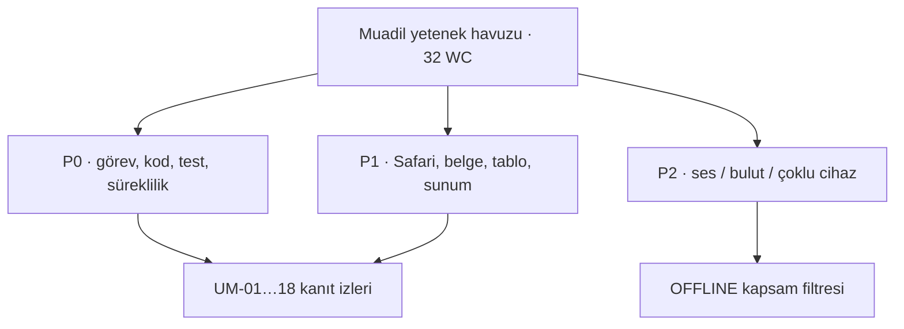

# H04 — Yetenek Haritası
## ENGÜRÜ UstaMimar OSi™ · Teori, Tasarım, Teknik Hazırlık ve Zülfikar V1.4.1

**Harita:** `H04` · **Hedef 1:** ACTIVE / HTML prototip · **Hedef 2:** PARKED / Mac OSi · **Yetki:** Owner.
**Kapsam hükmü:** `PASS_SCOPED_DESIGN_SELF_CHECKED_ONLY`. Bu harita, fiilen çalışan UstaMimar mühendislik ürününün ya da Mac kurulumu kabulünün kanıtı değildir.

### Niyet ve kapsam
32 muadil başlığın ve 18 UM izinin gerçek araçla yapılabilirliğini ve önceliğini ayırmak.

**Ana soru:** Usta neleri gerçekten yapabilir; neler sıradadır?
**Sorumlu rol:** Yetenek kataloğu (tek defter)

### Kaynak ve bütünlük
Kaynak: owner V1.2 ürün kararı; V1.1 hizalama; V1 temel iş/kabul sözleşmesi; özgün UM V1 matrisi ve yalnız salt-okunur GitHub AGENTS.md referansı. Asıl SHA-256 eşlikleri üst `HARITALAR_V1_KAYNAK_MATRISI.json` içindedir. Git blob SHA-1 ile SHA-256 farklıdır; ana Saray'a yazma yetkisi türetilmez.

### Kuramsal ilkeler ve mimari sınırlar
- P0 çekirdek çok adımlı iş, kod, dosya, test, finiş
- P1 Safari, belge/tablo/sunum, yerel arama
- P2 ses/medya ve çevrimdışı kapsam dışı bulut olanakları

### Şema

### Teknik giriş–çıkış ve bağlantı sözleşmesi
**Girdi**
- WC-01..WC-32 tarihsel tasarım referansı
- UM-01..UM-18 tasarım izleri

**Çıktı**
- capability_id→araç→kanıt→dürüst durum matrisi
- P0/P1/P2 sıralaması

**Arayüz ve veri bağı (hedef tasarım; mevcut API iddiası değil)**
- UM-01..18 ↔ kaynak R ve W eşleşmesi
- muadil kanıt yoksa comparator_state NOT_TESTED

**Bağlı üst/yan haritalar:** H05, H08.
**Korunan gereksinim/iş/yetenek izleri:** R01, R11, UM-01, UM-03, UM-04, UM-06, UM-08, UM-12, UM-18, W02, W05, W09. 4H özgün H01/H02/DG02/DG03/DG04 koşulları ayrı asıl sözleşmelerden doğrulanır.

### Zülfikar V1.4.1 · Üçlü senaryo / onarım
- **SIM1 (normal):** 32 WC tekil tasarım izi ayrı gereksinime ve P sırasına bağlı. Beklenen hüküm `PASS_DESIGN_RULE_ONLY`; gerçek icra makbuzu talep edilirse `NOT_TESTED`.
- **SIM2 (karşıt):** Canlı bulut tarayıcı özelliği OFFLINE hedefe PASS olarak yazılamaz. Beklenen hüküm `SAFE_REJECT`, yetkisiz dış etki 0.
- **SIM3 (kesinti/onarım):** Belirsiz muadil alanı CANDIDATE/NOT_TESTED tut, gerektiğinde kapsam dışına ayrıştır. Beklenen hüküm `HOLD_OR_RECOVERY_NOT_FAKE_FINISH`.
- **Döngü Onarım:** Gözlem → kök neden → dar değişiklik → yeniden SIM1/SIM2/SIM3 → regresyon → yalnız kanıtlı hüküm.

### Kabul şartı / beklenen teslim
**Tasarım uygunluğu:** 32 WC ve 18 UM eksiksiz eşlenir; gerçek araçsız yetenek PASS alamaz.
**Tasarım riskleri:** muadil özel yetenekleri yerel eşdeğer ilan etmek, tasarım kapsamının gerçek işlev sayılması.

**Yapısal tasarım değerlendirmesi (10 bağımsız anlam başlığı × 10 puan):** G01, G02, G03, G04, G05, G06, G07, G08, G09, G10. Bu belgede tüm alanlar bulunduğu için yerel kendi-yazarlı rubrik `100/100`; kapsam `SELF_ASSESSED_DESIGN`. Harici hakem veya gerçek teknik performans olarak değerlendirilmez.

**Hedef 1 gerçek bitiş için:** 32 WC ve 18 UM eksiksiz eşlenir; gerçek araçsız yetenek PASS alamaz. İlgili kod, gerçek görev/araç/test makbuzları ve ürünün özgün kabul kimlikleri W07–W14 aşamasında ayrıca kanıtlanır.
**Hedef 2:** `PARKED`; `MAC_INSTALL_GO=NOT_GRANTED`, `W15/M01–M06=NOT_TESTED`. Gerçek işletim, gerçek model ve Mac saha yeteneği burada test edilmemiştir.

### Muadil yetenekleriyle kaynak bağı
Seçilecek gerçek mühendislik beceri desenlerinin ayrıntılı sahiplik ve kimlik eşliği `../MUADIL_YETENEK_EK_H04.md` dosyasındadır. Work, Claude Code, Codex ve Aider kaynakları referanstır; kullanıcı sahibi ayrı izin vermeden çevrimiçi entegrasyon açılmaz.
