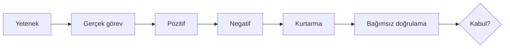

# H05 — Yeterlilik Haritası
## ENGÜRÜ UstaMimar OSi™ · Teori, Tasarım, Teknik Hazırlık ve Zülfikar V1.4.1

**Harita:** `H05` · **Hedef 1:** ACTIVE / HTML prototip · **Hedef 2:** PARKED / Mac OSi · **Yetki:** Owner.
**Kapsam hükmü:** `PASS_SCOPED_DESIGN_SELF_CHECKED_ONLY`. Bu harita, fiilen çalışan UstaMimar mühendislik ürününün ya da Mac kurulumu kabulünün kanıtı değildir.

### Niyet ve kapsam
Yetenek iddialarını gerçek kullanıcı işi, karşıt test ve bağımsız doğrulamaya bağlamak.

**Ana soru:** Beceri ne ölçüde tekrarlanabilir ve güvenilir?
**Sorumlu rol:** Yetkinlik oracle + ayrı verifier

### Kaynak ve bütünlük
Kaynak: owner V1.2 ürün kararı; V1.1 hizalama; V1 temel iş/kabul sözleşmesi; özgün UM V1 matrisi ve yalnız salt-okunur GitHub AGENTS.md referansı. Asıl SHA-256 eşlikleri üst `HARITALAR_V1_KAYNAK_MATRISI.json` içindedir. Git blob SHA-1 ile SHA-256 farklıdır; ana Saray'a yazma yetkisi türetilmez.

### Kuramsal ilkeler ve mimari sınırlar
- doğru işlev ve kalite
- yetkisiz işlem 0 / sahte PASS 0
- kesinti, dayanıklılık ve ölçülmüş kaynak bütçesi
- doğrulama üreticiden ayrı

### Şema

### Teknik giriş–çıkış ve bağlantı sözleşmesi
**Girdi**
- UM-01..18 ve ilgili özgün 56 ID
- H03 gerçek test makbuzları

**Çıktı**
- yeterlilik id / ölçüt / metrik / kanıt
- PASS_SCOPED/HOLD/NOT_TESTED

**Arayüz ve veri bağı (hedef tasarım; mevcut API iddiası değil)**
- acceptance_id, threshold, actual, evidence_sha, verifier_ref
- ürün 56 özgün ID paydası bozulmaz

**Bağlı üst/yan haritalar:** H06, H08.
**Korunan gereksinim/iş/yetenek izleri:** R11, R12, R14, UM-06, UM-08, UM-09, UM-11, UM-18, W09, W12, W13. 4H özgün H01/H02/DG02/DG03/DG04 koşulları ayrı asıl sözleşmelerden doğrulanır.

### Zülfikar V1.4.1 · Üçlü senaryo / onarım
- **SIM1 (normal):** İki ayrı gerçek iş ve üçlü test için kanıt zorunludur. Beklenen hüküm `PASS_DESIGN_RULE_ONLY`; gerçek icra makbuzu talep edilirse `NOT_TESTED`.
- **SIM2 (karşıt):** Bozuk test makbuzu veya yanlış SHA PASS veremez. Beklenen hüküm `SAFE_REJECT`, yetkisiz dış etki 0.
- **SIM3 (kesinti/onarım):** RED→kök neden→onarılan kod→GREEN→karşıt→regresyon. Beklenen hüküm `HOLD_OR_RECOVERY_NOT_FAKE_FINISH`.
- **Döngü Onarım:** Gözlem → kök neden → dar değişiklik → yeniden SIM1/SIM2/SIM3 → regresyon → yalnız kanıtlı hüküm.

### Kabul şartı / beklenen teslim
**Tasarım uygunluğu:** Her özgün ID ayrı delil taşır; eksik kanıtta tüm ürün PASS olmaz.
**Tasarım riskleri:** tek geçişli demo başarıya eşdeğer sanılması, öz doğrulama bağımsız reviewer sayılması.

**Yapısal tasarım değerlendirmesi (10 bağımsız anlam başlığı × 10 puan):** G01, G02, G03, G04, G05, G06, G07, G08, G09, G10. Bu belgede tüm alanlar bulunduğu için yerel kendi-yazarlı rubrik `100/100`; kapsam `SELF_ASSESSED_DESIGN`. Harici hakem veya gerçek teknik performans olarak değerlendirilmez.

**Hedef 1 gerçek bitiş için:** Her özgün ID ayrı delil taşır; eksik kanıtta tüm ürün PASS olmaz. İlgili kod, gerçek görev/araç/test makbuzları ve ürünün özgün kabul kimlikleri W07–W14 aşamasında ayrıca kanıtlanır.
**Hedef 2:** `PARKED`; `MAC_INSTALL_GO=NOT_GRANTED`, `W15/M01–M06=NOT_TESTED`. Gerçek işletim, gerçek model ve Mac saha yeteneği burada test edilmemiştir.
