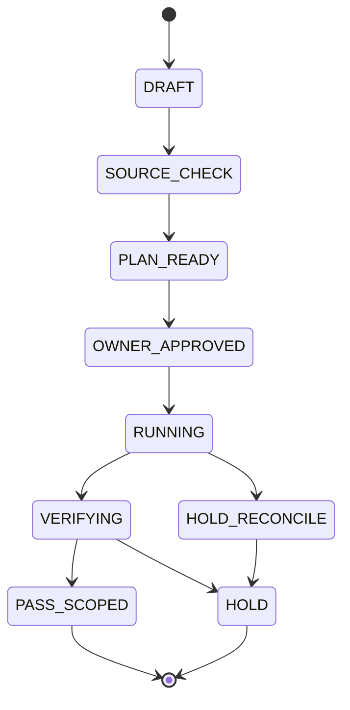

# H06 — Görev, Süreklilik ve Finiş
## ENGÜRÜ UstaMimar OSi™ · Teori, Tasarım, Teknik Hazırlık ve Zülfikar V1.4.1

**Harita:** `H06` · **Hedef 1:** ACTIVE / HTML prototip · **Hedef 2:** PARKED / Mac OSi · **Yetki:** Owner.
**Kapsam hükmü:** `PASS_SCOPED_DESIGN_SELF_CHECKED_ONLY`. Bu harita, fiilen çalışan UstaMimar mühendislik ürününün ya da Mac kurulumu kabulünün kanıtı değildir.

### Niyet ve kapsam
Tek işin durum makinesini, kesintiden devam ve doğru kapanışını belirlemek.

**Ana soru:** Görev nerede başladı, nerede kaldı, nasıl doğrulandı?
**Sorumlu rol:** Tek SQLite görev defteri

### Kaynak ve bütünlük
Kaynak: owner V1.2 ürün kararı; V1.1 hizalama; V1 temel iş/kabul sözleşmesi; özgün UM V1 matrisi ve yalnız salt-okunur GitHub AGENTS.md referansı. Asıl SHA-256 eşlikleri üst `HARITALAR_V1_KAYNAK_MATRISI.json` içindedir. Git blob SHA-1 ile SHA-256 farklıdır; ana Saray'a yazma yetkisi türetilmez.

### Kuramsal ilkeler ve mimari sınırlar
- tek task_id, idempotency_key ve sözleşme SHA
- checkpoint/restart/atomik durum
- HOLD_RECONCILE + güvenli devam
- finish/next_action + makbuz

### Şema

### Teknik giriş–çıkış ve bağlantı sözleşmesi
**Girdi**
- H01 görev ve owner onayı
- H02 plan, H03 araç çıktısı

**Çıktı**
- tek görev/jobu bağlayan kanıt zinciri
- ilerleme / açık durum / sonraki hareket

**Arayüz ve veri bağı (hedef tasarım; mevcut API iddiası değil)**
- DRAFT→SOURCE_CHECK→PLAN_READY→OWNER_APPROVED→RUNNING→VERIFYING
- PASS_SCOPED veya HOLD/BLOCKED/CANCELLED; UNKNOWN→HOLD_RECONCILE

**Bağlı üst/yan haritalar:** H07, H08.
**Korunan gereksinim/iş/yetenek izleri:** R02, R05, R12, UM-01, UM-09, UM-10, UM-18, W07, W10, W12, W14. 4H özgün H01/H02/DG02/DG03/DG04 koşulları ayrı asıl sözleşmelerden doğrulanır.

### Zülfikar V1.4.1 · Üçlü senaryo / onarım
- **SIM1 (normal):** Tam görev, tek job ve bağlı kanıt ile VERIFYING sonrası doğrulama. Beklenen hüküm `PASS_DESIGN_RULE_ONLY`; gerçek icra makbuzu talep edilirse `NOT_TESTED`.
- **SIM2 (karşıt):** Aynı idempotency_key yeni yan etki oluşturmaz; yetkisiz geçiş reddedilir. Beklenen hüküm `SAFE_REJECT`, yetkisiz dış etki 0.
- **SIM3 (kesinti/onarım):** Süreç çökmesi kalıcı defterden devam, belirsiz etki uzlaştırma HOLD. Beklenen hüküm `HOLD_OR_RECOVERY_NOT_FAKE_FINISH`.
- **Döngü Onarım:** Gözlem → kök neden → dar değişiklik → yeniden SIM1/SIM2/SIM3 → regresyon → yalnız kanıtlı hüküm.

### Kabul şartı / beklenen teslim
**Tasarım uygunluğu:** Yeniden başlama sonrası görev kaybı 0 ve mükerrer dış etki 0 hedefi gerçek testte kanıtlanır.
**Tasarım riskleri:** restart ardından mükerrer dış etki, erken PASS ve checkpoint yok.

**Yapısal tasarım değerlendirmesi (10 bağımsız anlam başlığı × 10 puan):** G01, G02, G03, G04, G05, G06, G07, G08, G09, G10. Bu belgede tüm alanlar bulunduğu için yerel kendi-yazarlı rubrik `100/100`; kapsam `SELF_ASSESSED_DESIGN`. Harici hakem veya gerçek teknik performans olarak değerlendirilmez.

**Hedef 1 gerçek bitiş için:** Yeniden başlama sonrası görev kaybı 0 ve mükerrer dış etki 0 hedefi gerçek testte kanıtlanır. İlgili kod, gerçek görev/araç/test makbuzları ve ürünün özgün kabul kimlikleri W07–W14 aşamasında ayrıca kanıtlanır.
**Hedef 2:** `PARKED`; `MAC_INSTALL_GO=NOT_GRANTED`, `W15/M01–M06=NOT_TESTED`. Gerçek işletim, gerçek model ve Mac saha yeteneği burada test edilmemiştir.
