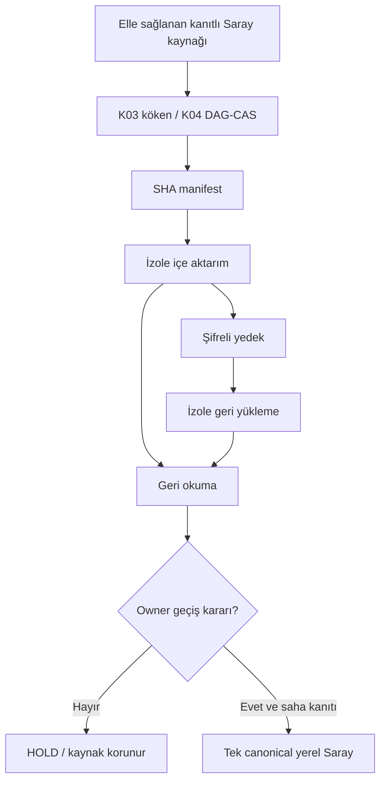

# H07 — Güvenlik, Hafıza ve Kurtarma
## ENGÜRÜ UstaMimar OSi™ · Teori, Tasarım, Teknik Hazırlık ve Zülfikar V1.4.1

**Harita:** `H07` · **Hedef 1:** ACTIVE / HTML prototip · **Hedef 2:** PARKED / Mac OSi · **Yetki:** Owner.
**Kapsam hükmü:** `PASS_SCOPED_DESIGN_SELF_CHECKED_ONLY`. Bu harita, fiilen çalışan UstaMimar mühendislik ürününün ya da Mac kurulumu kabulünün kanıtı değildir.

### Niyet ve kapsam
Yetki sınırı ve Saray göçünü bir tek güvenilir kayıt çizgisine bağlamak.

**Ana soru:** Kazanımlar nasıl korunur, eski kayıplar nasıl görünür tutulur?
**Sorumlu rol:** Owner + korumalı kayıt/adaptör

### Kaynak ve bütünlük
Kaynak: owner V1.2 ürün kararı; V1.1 hizalama; V1 temel iş/kabul sözleşmesi; özgün UM V1 matrisi ve yalnız salt-okunur GitHub AGENTS.md referansı. Asıl SHA-256 eşlikleri üst `HARITALAR_V1_KAYNAK_MATRISI.json` içindedir. Git blob SHA-1 ile SHA-256 farklıdır; ana Saray'a yazma yetkisi türetilmez.

### Kuramsal ilkeler ve mimari sınırlar
- allowlist/origin/CSRF ve prompt injection ret
- HFS-S1 köken, HFS-S2 DAG/CAS
- HFS-S3 manifestli import, HFS-S4 şifreli yedek/restore
- HFS-S5 tek yazar/başlatma ve seçici K12

### Şema

### Teknik giriş–çıkış ve bağlantı sözleşmesi
**Girdi**
- owner tarafından elle içeri aktarılan kaynağı doğrulanmış dosyalar
- H06 görevin yetki, hash ve durum zinciri

**Çıktı**
- Saray göç denemesi ve SHA manifesti
- kurtarma kanıtı ve kaynak eksiği HOLD

**Arayüz ve veri bağı (hedef tasarım; mevcut API iddiası değil)**
- K03 5 eksik özgün sohbet / K04 tarihsel DAG açıklığı
- 22 benzersiz gain_id korunur
- CAS + parent_sha + version, double-writer ret

**Bağlı üst/yan haritalar:** H08.
**Korunan gereksinim/iş/yetenek izleri:** R03, R07, R13, R14, UM-11, UM-12, UM-13, UM-14, UM-15, UM-16, UM-17, W05, W10, W11. 4H özgün H01/H02/DG02/DG03/DG04 koşulları ayrı asıl sözleşmelerden doğrulanır.

### Zülfikar V1.4.1 · Üçlü senaryo / onarım
- **SIM1 (normal):** Kaynaklı veri izole workspace içine kayıpsız içe alınır ve SHA geri okunur. Beklenen hüküm `PASS_DESIGN_RULE_ONLY`; gerçek icra makbuzu talep edilirse `NOT_TESTED`.
- **SIM2 (karşıt):** Sahte otorite, çakışmalı CAS veya şüpheli kaynak fail-closed; K03/K04 tam PASS edilmez. Beklenen hüküm `SAFE_REJECT`, yetkisiz dış etki 0.
- **SIM3 (kesinti/onarım):** Bağımsız şifreli yedekten izole restore ile bütünlük; owner cutover ayrı. Beklenen hüküm `HOLD_OR_RECOVERY_NOT_FAKE_FINISH`.
- **Döngü Onarım:** Gözlem → kök neden → dar değişiklik → yeniden SIM1/SIM2/SIM3 → regresyon → yalnız kanıtlı hüküm.

### Kabul şartı / beklenen teslim
**Tasarım uygunluğu:** Göç tam kabul için kaynak+22 ID+DAG+manifest+backup+restore+restart+tek yazar+owner; eksikte HOLD.
**Tasarım riskleri:** eksik orijinal sohbeti uydurarak tamamlamak, ana indeksi kör yazmak, ikinci ana hafıza başlatmak.

**Yapısal tasarım değerlendirmesi (10 bağımsız anlam başlığı × 10 puan):** G01, G02, G03, G04, G05, G06, G07, G08, G09, G10. Bu belgede tüm alanlar bulunduğu için yerel kendi-yazarlı rubrik `100/100`; kapsam `SELF_ASSESSED_DESIGN`. Harici hakem veya gerçek teknik performans olarak değerlendirilmez.

**Hedef 1 gerçek bitiş için:** Göç tam kabul için kaynak+22 ID+DAG+manifest+backup+restore+restart+tek yazar+owner; eksikte HOLD. İlgili kod, gerçek görev/araç/test makbuzları ve ürünün özgün kabul kimlikleri W07–W14 aşamasında ayrıca kanıtlanır.
**Hedef 2:** `PARKED`; `MAC_INSTALL_GO=NOT_GRANTED`, `W15/M01–M06=NOT_TESTED`. Gerçek işletim, gerçek model ve Mac saha yeteneği burada test edilmemiştir.
