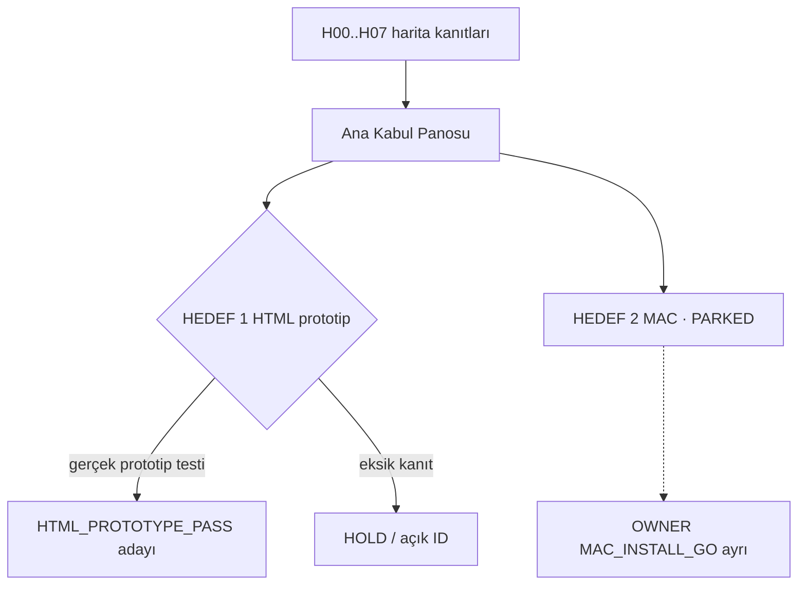

# H08 — Kalite, Muadil Kıyas ve İki Aşamalı Kabul
## ENGÜRÜ UstaMimar OSi™ · Teori, Tasarım, Teknik Hazırlık ve Zülfikar V1.4.1

**Harita:** `H08` · **Hedef 1:** ACTIVE / HTML prototip · **Hedef 2:** PARKED / Mac OSi · **Yetki:** Owner.
**Kapsam hükmü:** `PASS_SCOPED_DESIGN_SELF_CHECKED_ONLY`. Bu harita, fiilen çalışan UstaMimar mühendislik ürününün ya da Mac kurulumu kabulünün kanıtı değildir.

### Niyet ve kapsam
Dokuz haritayı özgün ID’lere ve iki ayrı teslim hedefine bağlamak.

**Ana soru:** Hedef 1 gerçekten ne zaman PASS, Hedef 2 ne zaman açılabilir?
**Sorumlu rol:** Ana Kabul Panosu / bağımsız denetçi / owner

### Kaynak ve bütünlük
Kaynak: owner V1.2 ürün kararı; V1.1 hizalama; V1 temel iş/kabul sözleşmesi; özgün UM V1 matrisi ve yalnız salt-okunur GitHub AGENTS.md referansı. Asıl SHA-256 eşlikleri üst `HARITALAR_V1_KAYNAK_MATRISI.json` içindedir. Git blob SHA-1 ile SHA-256 farklıdır; ana Saray'a yazma yetkisi türetilmez.

### Kuramsal ilkeler ve mimari sınırlar
- Hedef 1 ACTIVE: izole çalışan HTML prototip
- Hedef 2 PARKED: Mac OSi; owner MAC_INSTALL_GO bekler
- 56 özgün 4H + 18 UM iz + 32 WC tasarım kıyası
- SIM1/SIM2/SIM3 ve DoneCheck/owner ayrımı

### Şema

### Teknik giriş–çıkış ve bağlantı sözleşmesi
**Girdi**
- H00..H07 haritaları ve kanıtları
- kaynak SHA / görev/test/verifier makbuzu

**Çıktı**
- aktif Hedef 1 kabul özeti
- Hedef 2 ayrı park durumu ve açma şartı

**Arayüz ve veri bağı (hedef tasarım; mevcut API iddiası değil)**
- map_state per map; target1_state/target2_state ayrı
- PASS_SCOPED_DESIGN ≠ HTML_PROTOTYPE_PASS ≠ MAC_WORKING_PRODUCT
- BUILD_GO ve MAC_INSTALL_GO ayrı owner yetkileri

**Bağlı üst/yan haritalar:** H00.
**Korunan gereksinim/iş/yetenek izleri:** R14, UM-11, UM-18, W01, W02, W06, W12, W13, W14, W15. 4H özgün H01/H02/DG02/DG03/DG04 koşulları ayrı asıl sözleşmelerden doğrulanır.

### Zülfikar V1.4.1 · Üçlü senaryo / onarım
- **SIM1 (normal):** Yalnız gereken ID ve bağımsız kanıt varsa ilgili hedef PASS. Beklenen hüküm `PASS_DESIGN_RULE_ONLY`; gerçek icra makbuzu talep edilirse `NOT_TESTED`.
- **SIM2 (karşıt):** Simülasyon makbuzu gerçek Mac veya HTML icrası yerine geçemez. Beklenen hüküm `SAFE_REJECT`, yetkisiz dış etki 0.
- **SIM3 (kesinti/onarım):** Eksik özgün ID ve kaynak drift açık durumda tutulur; hatalı PASS geri çekilir. Beklenen hüküm `HOLD_OR_RECOVERY_NOT_FAKE_FINISH`.
- **Döngü Onarım:** Gözlem → kök neden → dar değişiklik → yeniden SIM1/SIM2/SIM3 → regresyon → yalnız kanıtlı hüküm.

### Kabul şartı / beklenen teslim
**Tasarım uygunluğu:** H1 ve H2 ayrı durumlar; H2 açıkça PARKED; sadece owner yetkisiyle saha açılır.
**Tasarım riskleri:** 100/100 yapısal harita puanını çalışan HTML saymak, Hedef 2 hazır olmadan Mac’e geçiş.

**Yapısal tasarım değerlendirmesi (10 bağımsız anlam başlığı × 10 puan):** G01, G02, G03, G04, G05, G06, G07, G08, G09, G10. Bu belgede tüm alanlar bulunduğu için yerel kendi-yazarlı rubrik `100/100`; kapsam `SELF_ASSESSED_DESIGN`. Harici hakem veya gerçek teknik performans olarak değerlendirilmez.

**Hedef 1 gerçek bitiş için:** H1 ve H2 ayrı durumlar; H2 açıkça PARKED; sadece owner yetkisiyle saha açılır. İlgili kod, gerçek görev/araç/test makbuzları ve ürünün özgün kabul kimlikleri W07–W14 aşamasında ayrıca kanıtlanır.
**Hedef 2:** `PARKED`; `MAC_INSTALL_GO=NOT_GRANTED`, `W15/M01–M06=NOT_TESTED`. Gerçek işletim, gerçek model ve Mac saha yeteneği burada test edilmemiştir.
